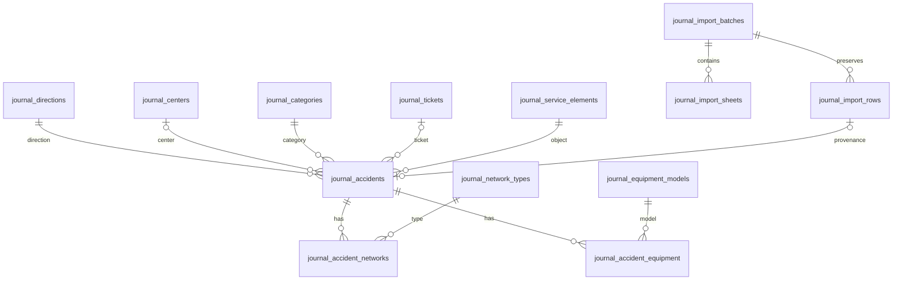

# Журнал аварий: модель на основе реальной сводки

Клиент: обычные HTML, CSS и JavaScript. Сервер: C#/.NET 8 REST API. База: MariaDB 10.1. Запуск: `docker compose --env-file .env.case -f docker-compose.case.yml -p motiv-case up -d --build`. Браузер: http://localhost:5090. Инструкция по паролям — в `.env.case.example`; реальные секреты и исходный Excel не коммитятся.

## Что включено

Просмотр, поиск, фильтры, пагинация, создание и редактирование аварий; экспорт CSV, роли и аудит. Обзор показывает количество записей, закрытые события, НВ в архивном источнике отдельно от текущих, распределения по направлениям и типам, начало событий по месяцам. Это статистика записей, а не доказанная доступность сети или SLA.

Импортируются подробные листы «Аварии на сети СС» и «Аварии на сети ФС». «Основные события» сохраняются отдельно: их нельзя просто прибавлять к подробным строкам. «Недозвоны», «Остановленные БС», «Запуск-вывод БС» сохранены в архиве импорта для следующего этапа, без отдельных экранов.

## Почему схема разделена

`journal_accidents` хранит факты события: ссылки на справочники, описание, начало/окончание, количество БС, измеренные длительности и версию. Названия направлений и ТЦ не повторяются в каждой записи. Они зависят от собственного ключа и хранятся в `journal_directions`, `journal_centers`. Аналогично устроены категории, типы аварий и типы сетей.

Несколько сетей или моделей оборудования в одном событии связаны через `journal_accident_networks` и `journal_accident_equipment`: связь многие ко многим, составной первичный ключ исключает повтор связи. GSM + LTE — две связи, а не строка с несколькими значениями. Отдельные модели оборудования разделяются только по явно указанным переносам строк, без угадывания по пробелам.

`journal_service_elements` хранит полное название объекта. Код до тире в обезличенных данных не уникален, поэтому по нему объекты не объединяются. `journal_tickets` хранит номер/ссылку заявки; одна заявка может относиться к нескольким событиям. Уникальности номера заявки в таблице событий нет. Для длинных точных названий используется SHA-256 и дополнительная проверка совпадения текста; это позволяет обойти ограничение индексов старой MariaDB без обрезания.

Направление и ТЦ хранятся независимыми внешними ключами: файл не даёт надёжного правила принадлежности каждого ТЦ направлению. Районы и адреса не извлекаются автоматически из свободного текста. Создавать выдуманные зависимости ради формальной декомпозиции нельзя.

`journal_categories` содержит исходный код и необязательное подтверждённое соответствие 1–3. Латинские A0/B и кириллические А0/В различаются. Соответствия для них не придуманы. Администраторское редактирование правил соответствия — следующий этап; текущая форма позволяет сохранить исходную категорию и показывает, что она требует сопоставления.

## Вычисления и неизвестные значения

Длительность события и общий простой не являются редактируемыми столбцами таблицы фактов. Представления `journal_report_base` и `journal_report` получают их SQL-запросом. Общий простой = число полных БС × простой одной БС, только когда оба значения известны. Сектор и неизвестное число БС дают NULL, а не 0 и не одну БС. Пустая длительность также NULL; явно записанный ноль остаётся нулём.

Длительности хранятся как `DECIMAL(20,3)` секунд. В исходнике есть интервалы больше 838:59:59; тип TIME потерял бы эти данные. Представление сохраняет смысл 19 полей PDF, но уточняет конфликтующие физические типы: категория может быть исходным кодом, окончание/неизвестные поля NULL, интервалы — секунды без ограничения TIME. Имена полей PDF доступны в представлении; физически избыточные LENGHT/COMMON_PROSTOY не сохраняются.

На сервере проверяются диапазоны, даты, категории и справочники; БД обеспечивает первичные, уникальные и внешние ключи, обязательность и типы. MariaDB 10.1 не следует считать обеспечивающей произвольные CHECK-ограничения. Записывать данные следует через API, а не обходить его SQL-вставками.

## Архив и время

Пользователь подтвердил, что часовой пояс Excel неизвестен. Поэтому даты сохраняются как `source_local`, без приписывания UTC. API возвращает `beginTimeLocal/endTimeLocal` без смещения; `beginTime/endTime` для этих записей — NULL. Оперативные UTC-записи используют обратную пару. Основание времени существующей записи при обычном редактировании менять нельзя.

НВ в архивном файле означает «не закрыто на дату источника». Длительность такой записи считается до явно подписанного снимка K1/L1 соответствующего листа. Если дата снимка неизвестна, длительность неизвестна. Для оперативной UTC-записи без окончания используется текущее серверное время. Исходные локальные интервалы не учитывают неизвестные изменения часового пояса/DST; их нельзя выдавать за точные международные временные интервалы.

Календарный фильтр применяется к сохранённым датам; при смешивании архивных и UTC-записей это обзор по календарным границам, а не сравнение единой временной шкалы. Для анализа выбирайте область «Архив» или «Оперативные». Кнопка «Весь период данных» открывает диапазон архивной сводки.

## Источник и повторяемый импорт

`journal_import_batches` — хеш файла, источник, автор, время импорта и результат. `journal_import_sheets` — снимок каждого листа. `journal_import_rows` — неизменяемые ячейки с формулами, кэшированными значениями, форматами, исходными числовыми serial, листом/строкой и предупреждениями. Это архив происхождения, а не альтернативная редактируемая таблица фактов. Исправления оператора меняют нормализованную запись; исходник остаётся прежним.

Повтор одного SHA-256 возвращает прежний результат без добавления событий и без восстановления удалённых оператором записей. Импорт выполняется транзакцией под блокировкой. Некорректная строка сохраняется в архиве с причиной и не попадает в факты; результат сообщает число таких строк. Подробные листы не дедуплицируются автоматически по заявке или коду БС: эти поля не являются уникальными ключами.

Требуется Python 3 и `openpyxl` (`python -m pip install openpyxl`). Сначала предварительный просмотр:

```powershell
python tools/import_workbook.py "C:\data\source.xlsx" --timezone unknown --output "C:\data\preview.json"
```

Проверив сводку, примените к локальному приложению:

```powershell
$env:CASE_IMPORT_PASSWORD = Read-Host "Пароль администратора"
python tools/import_workbook.py "C:\data\source.xlsx" --timezone unknown --apply --url http://127.0.0.1:5090
Remove-Item Env:CASE_IMPORT_PASSWORD
```

Без `--apply` HTTP-запросов нет. Для защиты случайной загрузки исходных данных скрипт допускает только явно указанный loopback-сервер. JSON предпросмотра содержит исходные тексты: храните его локально. Сам XLSX скрипт не изменяет. Новый участник команды получает код и инструкции из GitHub; исходный файл и импорт в его базу передаются отдельно согласованным способом.

## Обновление существующей базы

Приложение выполняет повторяемую миграцию версии 2 при запуске. Старые записи и их ID/версии/авторы переносятся в новые таблицы. `accident_reports` остаётся резервной таблицей прежней версии, API больше в неё не пишет. Аудит и пользователи сохраняются. Том не удаляется; `docker compose down -v` для обновления не нужен. Перед миграцией рабочей базы сделайте `mysqldump` и проверяйте обновление на копии.

## REST и чтение кода

`POST /api/auth/login` выдаёт JWT, `GET /api/auth/me` показывает пользователя. Токен клиента хранится в памяти. Изменение роли/отключение отзывает выданный доступ.

`GET /api/accidents/options` отдаёт динамические справочники, категории с mappedCategory и диапазон данных. `GET /api/accidents` — список; `GET /api/accidents/dashboard` — агрегаты с теми же фильтрами; `GET /api/accidents/{id}` — запись; `POST`, `PUT`, `DELETE` — изменения; `GET /api/accidents/export.csv` — весь отфильтрованный набор. Фильтры: from/to, direction, center, category или categoryCode, networkType, status, sourceScope, search; список дополнительно page/pageSize.

Дежурный и администратор могут создавать/редактировать. Удаляет администратор. Инженер просматривает и экспортирует. `PUT` требует version, `DELETE` — query version; конфликт возвращает 409. Управление пользователями и журнал действий доступны администратору через `/api/users` и `/api/accidents/audit`. `POST /api/accidents/import` — только администратор, до 20 MiB.

Начинайте с `wwwroot/app.js`: обработчик формы отправляет JSON. Controller проверяет запрос/права, AccidentStore в транзакции находит ID справочников и сохраняет только факты. Внешние ключи связывают факты со справочниками; SQL-представление собирает человекочитаемую запись и вычисления. Dashboard использует GROUP BY, COUNT и SUM. MySqlCommand получает значения через параметры, не конкатенацию пользовательского текста. Служебные SQL-имена фиксированы в коде.

## Проверки и границы прототипа

Есть HTTP-проверки CRUD/ролей/валидации/конфликтов/CSV, синтетические проверки парсера Excel и проверки нормализованного импорта/дашборда. Проверять следует настоящую MariaDB 10.1, а не заменять её SQLite. Исходные значения не помещаются в тесты и Git. Chrome 75 — целевая совместимость; точный старый браузер не установлен, поэтому нельзя объявлять его проверенным.

Пока нет отдельных экранов прочих листов, веб-мастера импорта XLSX и редактора сопоставлений категорий. Импорт выполняется командой, после него данные доступны для просмотра и редактирования в браузере. Это конкретные ограничения прототипа, а не скрытые готовые функции.

## Связи


