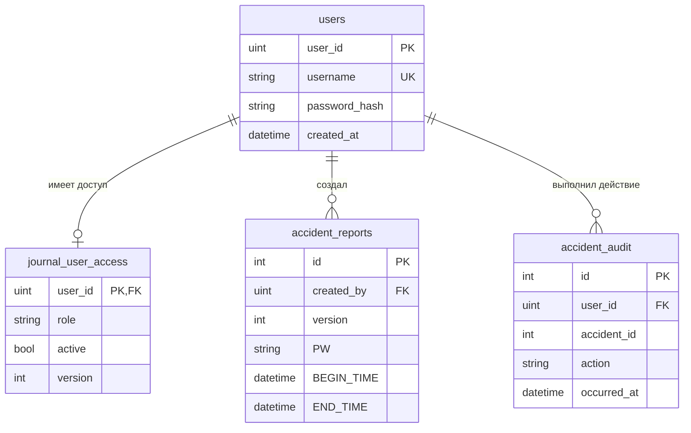

# База журнала аварий

Схема модуля находится в `db/journal.sql`. Она рассчитана на MariaDB 10.1 и создаётся идемпотентно: повторный запуск создания таблиц не должен удалять данные. Для русских букв используется `utf8mb4`; даты приложения — UTC.

## Таблицы и связи



Существующая `users` сохраняет прежнюю структуру. Скрипт создаёт её в прежнем формате только при отсутствии. Роли вынесены в отдельную `journal_user_access`, чтобы не ломать модель EF и работу коллег.

## accident_reports: 19 полей из PDF

Исходные названия сохранены, включая `TEHC`, `EQIP_TYPE` и `LENGHT`. В JSON используются понятные имена camelCase.

| № | SQL-поле / тип | JSON | Назначение |
|---|---|---|---|
| 1 | PW VARCHAR(450) | pw | Ссылка PW/NTT в CRM |
| 2 | NAPR VARCHAR(450) | direction | Направление из списка |
| 3 | TEHC VARCHAR(450) | center | Технический центр |
| 4 | KATEG TINYINT | category | Категория 1, 2 или 3 |
| 5 | NETW_TYPE VARCHAR(450) | networkType | GSM, LTE, LTE/GSM |
| 6 | SERV_ELEM VARCHAR(450) | serviceElement | Адреса/названия БС, вручную |
| 7 | NUMB_RBS INT | stationCount + isSector | Число БС либо сектор |
| 8 | EQIP_TYPE VARCHAR(450) | equipment | Описание оборудования |
| 9 | ALARM_TYPE VARCHAR(450) | alarmType | Тип аварии из списка |
| 10 | DESCR VARCHAR(450) | description | Краткое описание |
| 11 | BEGIN_TIME DATETIME | beginTime | Начало UTC |
| 12 | END_TIME DATETIME | endTime | Конец UTC; нулевая дата = НВ |
| 13 | AKB TIME | batterySeconds | Время работы от АКБ |
| 14 | DGU TIME | generatorSeconds | Время работы от генератора |
| 15 | LENGHT VARCHAR(450) | durationSeconds | Автоматическая длительность |
| 16 | PROSTOY TIME | downtimeSeconds | Средний простой одной БС |
| 17 | COMMON_PROSTOY TIME | totalDowntimeSeconds | Общий простой БС |
| 18 | ALARM_WHO VARCHAR(450) | notified | Кому/как сообщили |
| 19 | DESC_NOTICE VARCHAR(450) | notes | Подробное описание |

Технические поля: `id` — уникальный номер; `created_by` — автор, ссылка на `users.user_id`; `version` — версия для предотвращения потери одновременных правок. Эти поля нужны приложению, но не относятся к 19 содержательным полям PDF.

### Длительности и формулы

```text
durationSeconds = (endTime или текущее время сервера) − beginTime
totalDowntimeSeconds = downtimeSeconds × stationCount
```

Например: 3 БС × 1200 секунд = 3600 секунд (01:00:00). Общий простой — сумма станционного времени, а не длительность аварии.

Браузер показывает ЧЧ:ММ:СС, JSON передаёт целое число секунд, SQL хранит TIME. Это устраняет неоднозначность «время суток или длительность». 27:00:00 допустимо. TIME в MariaDB ограничен 838:59:59 = 3 020 399 секунд. Проверяются и исходные значения, и произведение: переполнение отклоняется, не обрезается молча.

`durationSeconds` и `totalDowntimeSeconds` рассчитывает сервер; клиент не может навязать свои значения. Для НВ длительность пересчитывается при получении ответа и экспорте. Снимок `LENGHT`, записанный ранее, не является актуальными часами продолжающейся аварии.

### НВ и сектор

- JSON `endTime: null` и UI «НВ» соответствуют нулевой DATETIME в SQL, как требует PDF. Нулевая дата не отправляется в браузер в виде ISO-строки.
- JSON `isSector:true, stationCount:null` означает «С (сектор)». INT не может хранить букву, поэтому в SQL используется документированный маркер. Сектор нельзя без правила заказчика приравнивать к одной БС; общий простой для него не определён (`null`).

Это техническое решение для неоднозначности задания. Маркер хранения и смысл сектора нужно согласовать при дальнейшем развитии; фронтенд работает через API и не зависит от SQL-маркера.

## journal_user_access

`user_id` связан с существующим пользователем. `role` — admin/duty/engineer; `active` — разрешён ли доступ к журналу; `version` — защита параллельного редактирования доступа.

Наличие строки в старой `users` само по себе не должно автоматически давать права администратора журнала. Присвоение роли выполняется явно. Демо-bootstrap не перезаписывает существующие пароли и права.

## accident_audit

Кто (`user_id`), какую аварию (`accident_id`), что сделал (`action`) и когда (`occurred_at`, UTC). Сохранение события и аудита выполняется согласованно. Это журнал действий, а не полная история версий: он не обещает восстановить предыдущее содержание записи.

## Период отчёта

Используется интервал `[from, to)`: начало включается, конец исключается. Выбираются события, пересекающие период. Авария, начавшаяся вчера и продолжающаяся сегодня, попадёт в сегодняшний отчёт. Длительности относятся ко всему событию; обрезка простоя по границам периода — отдельная аналитическая задача и не заявлена.

## Работа с существующей БД

1. Сделать резервную копию.
2. Проверить, что выбрана нужная БД и её версия.
3. Просмотреть `db/journal.sql` и применить только добавление таблиц журнала.
4. Явно назначить доступ существующим пользователям.
5. Проверить вход и чтение данных на копии базы.

Не использовать том MariaDB 11 в контейнере 10.1: смена тега Docker не является миграцией/понижением версии. Не применять старый KPI `init.sql` к 10.1: там используются возможности более новых версий. Не удалять том ради повторного запуска скрипта. Изменение SQL-файла в репозитории не означает, что уже созданная база автоматически обновилась.
